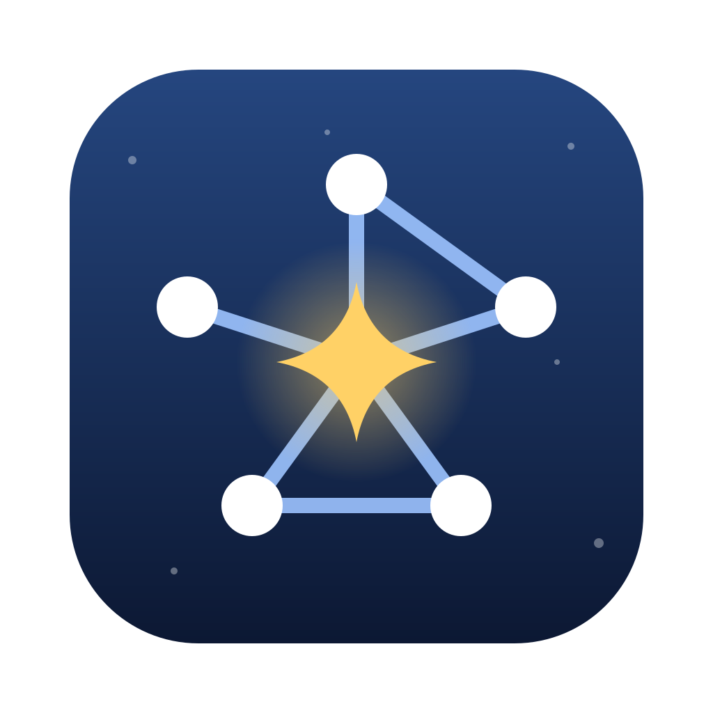

# Constella

ネットワークトポロジ図を作るための macOS アプリです。機器を置いてポートを選んでつなぐ GUI と、人や AI が書ける YAML が、双方向に同期します。

- **インターフェース中心**: 機器は機種(モデル)を持ち、機種に応じたポートが用意されます。リンクは必ず「機器:ポート」同士を結び、ポートの使用状況や二重使用もすぐ分かります。
- **GUI と YAML の双方向同期**: どちらで編集しても、もう一方にすぐ反映されます。YAML のコメントは残ります。
- **自動レイアウト**: 接続関係だけを書いた YAML も、開くと役割ごとの段に並びます。
- **ネットワーク情報の表示**: 拠点・ラック・VLAN・サブネットの枠、IF の IP と VLAN、L1 / L2 / L3 の表示切り替え。
- **そのほか**: SVG / PNG の書き出し、取り消し・やり直し、コピー&ペースト、実機の機種(ユーザーモデル)の追加。

## インストール

対応: macOS 13.3 以降(Apple Silicon・Intel)

1. [Releases](https://github.com/stellarcielo/Constella/releases) から `Constella_<バージョン>_universal.dmg` をダウンロードします。
2. DMG を開き、Constella を「アプリケーション」フォルダにドラッグします。
3. 初めて開くと、「Apple は “Constella” を検証できませんでした」のような表示が出ます。Apple の Developer ID での署名・公証をしていないためです。次の手順で開けます。
   1. 表示を「完了」(または「OK」)で閉じます。
   2. システム設定 > プライバシーとセキュリティ を開き、下の方にある「“Constella” は…」の横の「このまま開く」を押します。
   3. もう一度確認が出たら、「このまま開く」を押します。

2 回目からは、普通に開けます。

## 使い方

- 左のパレットから機器をキャンバスにドラッグして置き、「接続」モード(C キー)で 2 台をクリックしてポートを選ぶと、つながります。
- 右下の YAML エディタで、直接書くこともできます。書き方は [docs/SPEC.md](docs/SPEC.md) の 4 章と、[examples/](examples/) のサンプルを見てください。
- YAML の先頭に次の行を書くと、VS Code の YAML 拡張機能などで補完と検証が効きます(アプリで新規作成したファイルには、最初から入っています)。

  ```yaml
  # yaml-language-server: $schema=https://raw.githubusercontent.com/stellarcielo/Constella/main/schema/constella.schema.json
  ```

- 実機の機種は、パレットの「＋」から追加できます。保存先は `~/Library/Application Support/Constella/models/` です。

## 開発

必要なもの: Node.js、Rust、Xcode の Command Line Tools

```bash
npm install
npm run tauri dev
```

- 確認: `npm run typecheck && npm run lint && npm test && npm run format:check`
- 配布用のビルド(ユニバーサル版): `npm run build:mac`(Intel 用のターゲットが必要: `rustup target add x86_64-apple-darwin`)
- リリース: `v0.1.0` のようなタグを push すると、GitHub Actions がビルドして、下書きの Release に DMG を載せます。

仕様は [docs/SPEC.md](docs/SPEC.md)、開発の進め方は [CLAUDE.md](CLAUDE.md) にあります。
